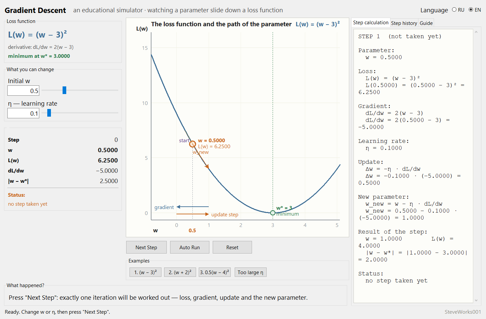
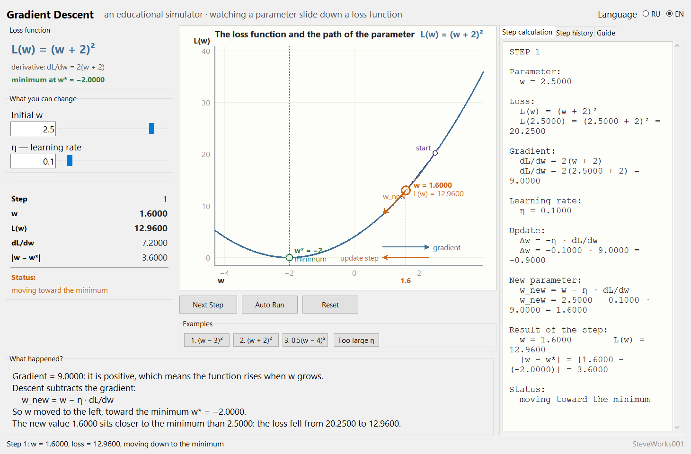
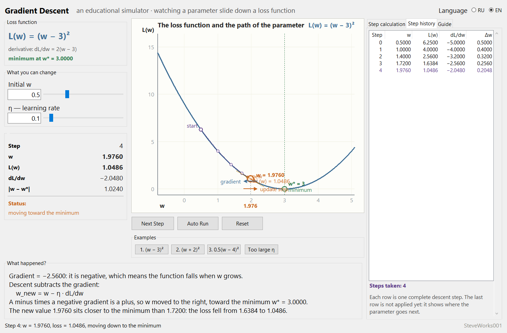
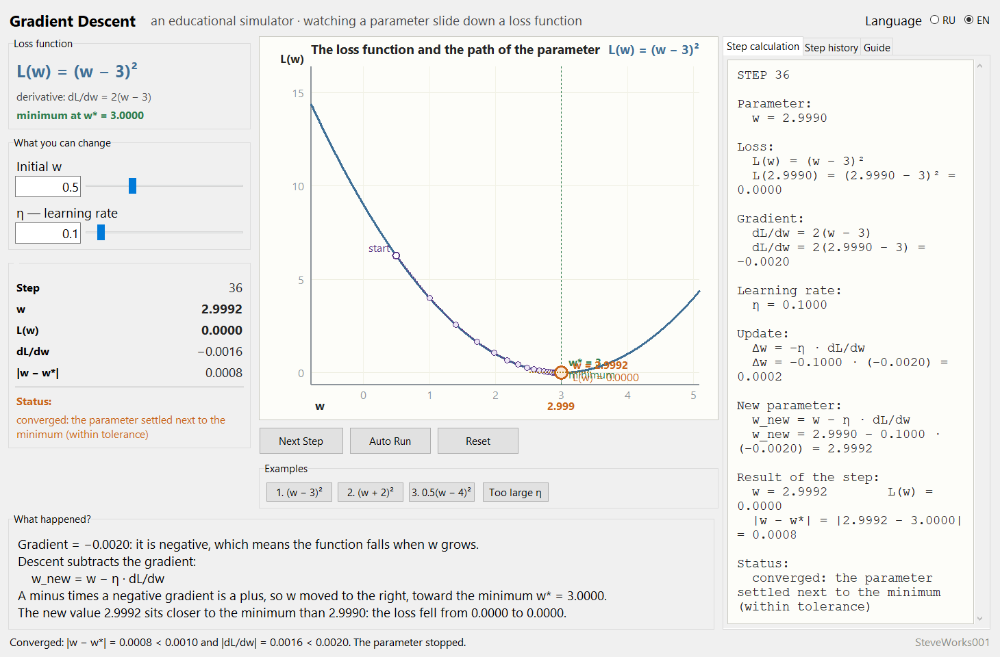

# Gradient Descent — An Educational Simulator

**[English](README_EN.md) | [Русский](README_RU.md)**

Project 4 of 13 in the educational neural-network simulator series.
A single-file Python and Tkinter application: standard library only, no external
packages, no network and no dependency installation.
It shows **how one parameter slides down a loss function**: one button press —
exactly one descent iteration, with the whole arithmetic of that step on screen.

---

## Purpose

Gradient descent hides no magic: at every step we ask the loss function which way makes it
worse, and take a small step in the opposite direction. One parameter, one formula, one
button per iteration — and after a handful of clicks you can watch a number find its own
minimum.

There are no neural networks, no datasets and no machine-learning libraries here. All of
the mathematics fits on screen and can be read line by line:

```text
current parameter w
      ↓
loss L(w)
      ↓
gradient dL/dw
      ↓
update Δw = −η · dL/dw
      ↓
new parameter w_new
      ↓
repeat
```

Change `w` or `η` and you can check every number by hand before it gets applied.

### What this project does not contain

- no neural-network training, no backpropagation, no descent over a dataset;
- no stochastic gradient descent, Adam, RMSProp or momentum;
- no multi-dimensional, non-convex or noisy functions — there is exactly one parameter;
- no datasets, epochs, quality metrics or training curves;
- no NumPy, PyTorch, TensorFlow, network access, databases or APIs.

One smooth one-dimensional function, one parameter and an exact derivative are enough to
see the central mechanism. Everything else belongs to other projects of the series.

---

## Learning goals

- Understand that gradient descent is a general optimization idea, not a property of one
  particular parabola.
- Understand why the gradient is **subtracted**: it points uphill.
- Take one step apart: loss → gradient → update → new parameter.
- Understand the role of the learning rate `η`, which turns a direction into an actual number.
- Read the sign of the gradient and predict which way the parameter will move.
- See numerical convergence: how `Δw` shrinks from step to step.
- Tell three regimes apart: monotone descent, overshooting the minimum, and divergence.
- Understand that the minimum is reached "within a tolerance", not exactly, and that this
  tolerance is stated openly.

---

## Mathematics: one descent step

**Optimization** is the search for parameter values that make some function as small as
possible. To say "smaller" you need a function that measures how bad things are.

**The loss function** `L` is that measure. In the main example it depends on a single
parameter `w`:

```text
L(w) = (w − 3)²          dL/dw = 2(w − 3)          minimum at w* = 3
```

At `w = 3` the loss is zero; the further `w` drifts from 3, the bigger the penalty. Real
machine learning works the same way, only with millions of parameters instead of one.

**The derivative** `dL/dw` answers one question: "if I increase `w` by a tiny amount, how
much does the loss grow?" At `w = 0.5` it equals `−5`: the loss falls when `w` grows. When
there is a single parameter, the derivative *is* the **gradient**; with many parameters the
gradient collects all partial derivatives into a vector and points in the direction of
steepest increase.

**Why the minus.** The gradient points uphill, so to go downhill we move against it:

```text
Δw = −η · dL/dw
w_new = w + Δw        that is    w_new = w − η · dL/dw
```

That minus sign is precisely why the method is called *descent*. Adding the gradient would
climb the loss function.

**The learning rate** `η` turns a direction into a concrete number. A small `η` means many
tiny steps; a large `η` means rough jumps over the minimum. `η` is not chosen by magic but
by watching the behaviour of the descent — that is what the slider and the dedicated
deliberately-too-large button are for.

### One step with the default numbers

Starting values: `w = 0.5000`, `η = 0.1000`. The first press of "Next Step" computes exactly
this — after the click the "Step calculation" panel reads, line by line:

```text
STEP 1

Parameter:
  w = 0.5000

Loss:
  L(w) = (w − 3)²
  L(0.5000) = (0.5000 − 3)² = 6.2500

Gradient:
  dL/dw = 2(w − 3)
  dL/dw = 2(0.5000 − 3) = −5.0000

Learning rate:
  η = 0.1000

Update:
  Δw = −η · dL/dw
  Δw = −0.1000 · (−5.0000) = 0.5000

New parameter:
  w_new = w − η · dL/dw
  w_new = 0.5000 − 0.1000 · (−5.0000) = 1.0000

Result of the step:
  w = 1.0000        L(w) = 4.0000
  |w − w*| = |1.0000 − 3.0000| = 2.0000

Status:
  moving toward the minimum
```

The sign is the whole explanation here: the gradient is negative, so `Δw` is positive and
the parameter moves **to the right**, toward the minimum.

The first four steps:

| Step | w before the step | L(w)   | dL/dw    | Δw     | w after the step |
|---|--------|----------|----------|--------|------------------|
| 0 | 0.5000 | 6.2500   | −5.0000  | 0.5000 | 1.0000           |
| 1 | 1.0000 | 4.0000   | −4.0000  | 0.4000 | 1.4000           |
| 2 | 1.4000 | 2.5600   | −3.2000  | 0.3200 | 1.7200           |
| 3 | 1.7200 | 1.6384   | −2.5600  | 0.2560 | 1.9760           |

Each next `Δw` is the previous one multiplied by `0.8`: the closer to the minimum, the
flatter the derivative, the more cautious the step. The same factor `0.8 = 1 − 2η` reappears
in the stability formula below.

### Convergence

The minimum counts as reached against an explicit tolerance, and both conditions have to
hold at the same time:

```text
|w − w*| < 0.001    and    |dL/dw| < 0.002
```

The program never claims exact convergence when a value is merely close: the status line
prints the actual numbers together with the tolerance, for example

```text
Converged: |w − w*| = 0.0008 < 0.0010 and |dL/dw| = 0.0016 < 0.0020.
```

There are also limits the descent is not allowed to cross: if `|w − w*|` exceeds `60`, the
descent stops with an explanation that it diverged; if `100` steps pile up, a message says
that with this `η` the descent is crawling.

### Stability: the factor (1 − 2η)

For `L(w) = (w − 3)²` the update collapses into a single line:

```text
w_new − 3 = (1 − 2η)(w − 3)
```

The factor `(1 − 2η)` decides everything: while its absolute value is below `1`, every step
lands closer to the minimum than the one before; once `|1 − 2η| > 1` (for this example that
is exactly `η > 1`), the jumps grow and the descent falls apart.

---

## Interface and usage

The screen has four zones.

**Left** — the "Loss function" box with the formula, the derivative and the position of the
minimum; the "What you can change" box with the `Initial w` and `η — learning rate` fields
(each has its own text entry and slider); and the current-state block with `Step`, `w`,
`L(w)`, `dL/dw`, `|w − w*|` and a status line.

**Centre** — the large graph, computed from the formula rather than drawn as a picture.
Below it sit the `Next Step`, `Auto Run` / `Stop` and `Reset` buttons and the "Examples" box.

**Right** — three tabs: "Step calculation" (the full arithmetic of the current step with
every substitution spelled out), "Step history" (the table) and "Guide" — 10 sections of
theory: what optimization is, the loss function, the parameter, the derivative, the
gradient, why the minus sign is there, the learning rate, what one step looks like, what
convergence means, and what goes wrong when `η` is too large.

**Bottom** — the "What happened?" panel, which explains this particular step, and a status
bar with the latest message.

### Step-by-step mode

`Next Step` is the core mode of the program. One press performs **exactly one** iteration:
the current point is highlighted, moves to its new position, the trajectory is extended, the
calculation panel is rebuilt, a row is added to the table, the step counter increases and
both explanation panels update. The highlight is short and never gets in the way while you
read the numbers.

Before the first press, "Step calculation" already shows the **upcoming** step, marked "not
taken yet": the numbers are on screen so you can check them by hand before they are applied.

### Automatic mode

`Auto Run` repeats the same step every 700 ms. While it runs the button turns into `Stop`,
and stopping is possible at any moment. The mode ends by itself when the minimum is reached,
when the step budget runs out, or when the descent diverges. `Reset` always interrupts it.
Step-by-step remains the primary mode: the automatic one exists only to let you see the
whole path in a single glance.

### The graph

The horizontal axis is the parameter `w`, the vertical axis is the loss `L(w)`. The graph
shows: the loss curve, computed from the formula; the minimum `w*` as a green vertical guide
line with a marker and a label; the descent trajectory as a dashed purple polyline through
every visited point; the starting point as a hollow circle labelled "start"; the current
point as an orange circle labelled `w = ...` and `L(w) = ...`; a vertical drop line from that
point to the `w` axis with its value under the axis; the tangent at the current point — its
slope follows the sign and size of `dL/dw` under the current axis scaling; an arrow from the
current point to the next one; and near the bottom of the plot two arrows — where the
**gradient** points and where the **update step** actually goes.

The plotted range adapts to the trajectory: as soon as the parameter travels further, the
axes rescale so the whole path stays visible. The link "number in the panel ↔ point on the
graph" is direct: the value printed under the `w` axis is the same `w` that appears in the
state block and in the history table.

### The `w` and `η` fields

Field and slider are tied together: type a number and the slider follows, drag the slider
and the number appears in the field. Allowed limits:

```text
η              from 0.005 to 1.20
Initial w      from (w* − 6) to (w* + 6)
```

A comma is accepted as a decimal separator. If you type something that is not a number, or
step outside the limits, the status bar says so and the last valid values are kept — the
interface cannot be broken. Any change to `Initial w` or `η` clears the trajectory and
restarts the descent from the new point, so the history always matches the current settings.

### Reset

`Reset` restores the original state of the selected example: initial `w`, `η`, step counter,
trajectory, current loss and gradient, the graph, and both panels.

### The history table

The "Step history" tab holds a compact table with five columns:

```text
Step | w       | L(w)     | dL/dw     | Δw
0    | 0.5000  | 6.2500   | −5.0000   | 0.5000
1    | 1.0000  | 4.0000   | −4.0000   | 0.4000
2    | 1.4000  | 2.5600   | −3.2000   | 0.3200
3    | 1.7200  | 1.6384   | −2.5600   | 0.2560
```

A row describes a whole step, so the `w` in it is the value **before** the step, and the
result of that step sits in the next row (or in the state block when there is no next row).
The table numbers steps from zero, while the calculation panel writes `STEP 1` for that same
first step: the two numbering schemes differ by one and describe the same iteration.

The last row (highlighted in colour) is the **upcoming** step — the same computation the next
button press will carry out. It disappears once the descent is finished.

The table gives what the graph cannot: numerical convergence. With `η = 0.1` each `Δw` is
the previous one multiplied by `0.8`.

### Descent status

The status line has five possible readings: `no step taken yet`, `moving toward the minimum`,
`moving away from the minimum — step too large`,
`converged: the parameter settled next to the minimum (within tolerance)` and
`the descent diverged: every jump over the minimum is bigger than the last`.
The "What happened?" panel describes the same step in sentences: what the gradient sign is,
which way the parameter moved because of it, and how the loss changed.

### Language

Everything visible is translated without restarting: buttons, labels, axis and graph
legends, statuses, explanations, the guide, example names, table headings and error
messages. Mathematical notation (`L(w) = (w − 3)²`, `dL/dw`, `η`, `Δw`, `w*`) is identical in
both languages and is never translated.

---

## Screenshots

The pictures below were taken from the running application (1460 × 960 pixel window,
English interface).

**Main window** — the default example `1. (w − 3)²`, no step taken yet. The "Step
calculation" tab shows the whole arithmetic of the step that is about to happen:
`w = 0.5000`, `dL/dw = −5.0000`, `Δw = 0.5000`, `w_new = 1.0000`:



**One step on example 2** — `L(w) = (w + 2)²`, start `w = 2.5000`. The gradient is positive
(`+9.0000`), so descent subtracts it and the parameter moves left to `w = 1.6000`; the loss
falls from 20.2500 to 12.9600:



**Step history** — the same example 1 after four presses of "Next Step". Each row is one
complete step, the `Δw` of a row equals the previous one multiplied by `0.8`, and the last
row is highlighted: it is the upcoming step that has not been applied yet:



**Convergence** — the default values after 36 steps: `w = 2.9992`, `|w − w*| = 0.0008`,
`|dL/dw| = 0.0016`. On the right there is the "Step calculation" tab with the arithmetic of
step 36 and the converged status, and the status line at the bottom prints the actual numbers
together with the tolerance:



---

## Example functions

Three ready-made functions, so it is clear that gradient descent is a general idea about
optimization and not a property of one particular parabola.

| Button | Function | Derivative | Minimum | Start | η |
|---|---|---|---|---|---|
| `1. (w − 3)²` | `L(w) = (w − 3)²` | `dL/dw = 2(w − 3)` | `w = 3` | 0.5 | 0.10 |
| `2. (w + 2)²` | `L(w) = (w + 2)²` | `dL/dw = 2(w + 2)` | `w = −2` | 2.5 | 0.10 |
| `3. 0.5(w − 4)²` | `L(w) = 0.5(w − 4)²` | `dL/dw = (w − 4)` | `w = 4` | 0.5 | 0.40 |

The first one is the main example and loads at startup. Example 2 shows the parameter
travelling to the left. Example 3 is a wider parabola: its derivative is smaller, so its
default `η` is larger — otherwise the descent would need far too many steps.

Non-convex and multi-dimensional functions are deliberately absent: the one-dimensional case
has to be understood first.

---

## Experiment: behaviour at different learning rates

The `Too large η` button sets `η = 1.05` on the main example. It is not a separate algorithm
— it is the ordinary learning-rate control pushed beyond the stable range: the factor
`1 − 2η = −1.1`, so every jump over the minimum ends up bigger than the previous one.

For the main example, starting from `w₀ = 0.5`, the descent behaves like this. Every row of
the table reproduces exactly: it is the same deterministic computation with the same tolerances
(`|w − w*| < 0.001`, `|dL/dw| < 0.002`), the same 100-step limit and the same guard at
`|w − w*| > 60` that the application uses. With a different starting `w` the step count changes,
naturally — the table describes this particular start:

| η | 1 − 2η | How the descent goes | Steps | Result |
|---|---|---|---|---|
| 0.02 | +0.96 | monotone but very slow | 100 | did not converge, reached `w ≈ 2.958` |
| 0.10 | +0.80 | monotone | 36 | converged |
| 0.30 | +0.40 | monotone | 9 | converged |
| 0.35 | +0.30 | monotone | 7 | converged |
| 0.50 | 0.00 | one step lands exactly on the minimum | 1 | `w = 3.0000` |
| 0.70 | −0.40 | overshoots, jumps shrink | 9 | converged |
| 0.90 | −0.80 | slowly damped overshooting | 36 | converged |
| 1.00 | −1.00 | endless jump between 0.5 and 5.5 | 100 | did not converge |
| 1.05 | −1.10 | jumps grow, the descent diverges | 34 | stopped by the guard |
| 1.20 | −1.40 | fast divergence | 10 | stopped by the guard |

Three lessons follow:

- a **small `η`** is reliable but sluggish;
- a **sensible `η`** converges in a handful of steps;
- a **large `η`** overshoots the minimum, and beyond `η = 1` the jumps grow and stability is
  lost completely.

On the graph the difference is obvious at once: in one case the points pile up at the
minimum, in the other the trajectory spreads out in both directions.

---

## Guided experiments

The numbers below come from the same deterministic computation the application performs at its
default settings, so they are reproducible: repeat an experiment and you get exactly these
lines. Working them out on paper first is the point, so compute, then press the button.

**1. Predict the pending step.** Start the program and, without pressing anything, open the
"Step calculation" tab.
Observe: it shows a step that has not happened yet — `w = 0.5000`, `L(w) = 6.2500`,
`dL/dw = −5.0000`, `Δw = 0.5000`, `w_new = 1.0000`. Compute those five numbers yourself, then
press `Next Step` and compare them with the new row of the history table.
Think about: why `Δw` is positive although the descent goes "down", and what exactly the sign
of the derivative says at this point.

**2. The factor 1 − 2η inside the table.** Take four steps with `η = 0.10` and read the `Δw`
column: `0.5000, 0.4000, 0.3200, 0.2560`.
Observe: every next `Δw` is the previous one multiplied by `0.8`, that is by `1 − 2η`, and the
factor does not depend on where you happen to be. Press `Reset`, set `η = 0.30` and check that
the factor becomes `0.40` while the descent ends in 9 steps instead of 36.
Think about: what the factor equals at `η = 0.50`, and why a single step is enough there.

**3. Sign of the gradient against direction of the step.** Set `Initial w = 5.0`, to the right
of the minimum `w* = 3`.
Observe: `dL/dw = +4.0000`, `Δw = −0.4000`, the point moves left, and the two arrows under the
graph — where the gradient points and where the step goes — face opposite ways. Repeat with
`Initial w = 0.5` and confirm the picture is mirrored.
Think about: if the direction is fully determined by the sign, why the descent needs the size
of the derivative at all — and what changes when the same derivative is multiplied by another
`η`.

**4. Two different kinds of failure.** Press `Too large η` (that is `η = 1.05`) and start
`Auto Run`.
Observe: the run stops at step 34, and the status talks about divergence: `w` left the minimum
`3.0000` by more than `60.0000`, so the distance guard triggered. Now `Reset` and set
`η = 1.00`: the factor is `−1.00`, the jumps stop growing, the point keeps swinging between
`0.5000` and `5.5000`, and what halts the descent is the 100-step limit — with the very same
message the program shows for a tiny `η`, complaining that the descent crawls.
Think about: why one and the same wording fits both the sluggish and the periodic case, and how
the two differ on the graph.

---

## Installation and launch

The application is a single file; no build step and no dependency installation are required.

Windows:

```bash
python gradient_descent.py
```

macOS and Linux:

```bash
python3 gradient_descent.py
```

The window opens at 1460 × 960 pixels; on a smaller screen it is trimmed to fit, but never
below 1320 × 700. Quick start: the main example `L(w) = (w − 3)²` is already loaded at launch,
so pressing `Next Step` a few times is enough.

The language switch is in the header: **RU** / **EN**.

---

## Requirements

- Python 3.8 or newer.
- Tkinter — included in the official Python builds for Windows and macOS; on some Linux
  distributions it is installed separately as the `python3-tk` package.
- Standard library only: `math`, `tkinter`, `tkinter.ttk`, `tkinter.font`.
- Not used: NumPy, pandas, SciPy, matplotlib, Pillow, TensorFlow, PyTorch, Keras,
  scikit-learn and anything else from `pip`.
- No network connection is required to run the application.

The application is intended for a typical desktop display: the graph occupies the centre of
the window. At the default size both right-hand panels — calculation and history — are fully
visible: the calculation block wraps long lines by words and its last line stays inside the
panel, and all five history columns fit even in the smallest 1320 × 700 window. When the
window is shorter, the calculation panel and the left column scroll.

---

## Limitations

- The application **does not train** a neural network: there is no dataset, no epochs, no
  network weights and no backpropagation.
- There is exactly **one** parameter, and the function is one-dimensional, smooth and
  convex; multi-dimensional, non-convex and noisy functions are not here.
- The derivative is given **analytically** for each of the three examples: there is no
  numerical differentiation and no automatic differentiation.
- Convergence is checked against a fixed tolerance (`|w − w*| < 0.001` and
  `|dL/dw| < 0.002`) — "exactly on the minimum" is never promised.
- Input limits are fixed: `η` from 0.005 to 1.20, initial `w` within `w* ± 6`; numbers
  outside the range are not accepted, and any edit clears the trajectory.
- Numbers use ordinary `float` precision: with a very small `η` the descent hits the 100-step
  limit, with a large one it hits the divergence guard.
- GUI only: there is no console mode, API or batch run.
- No save or load: state is not written to files and the graph is not exported.
- Two interface languages: Russian and English.

---

## Educational note

The simulator exists to make one mechanism understandable — how a gradient-descent step is
built from the loss and its derivative. Some choices are made for clarity: the convergence
tolerance, the 100-step limit and the guard at `|w − w*| > 60` decide when a descent counts as
finished, while a real system would use different criteria. The history table numbers steps
from zero while the calculation panel numbers the same step from one. The default `η` values
were fitted to the specific functions here, not taken as a "magic number" from practice.

---

## What to know beforehand

**Hard requirements:** Python 3 with Tkinter, and running one file from a command line. No `pip`
packages, no network, no external files.

**Mathematics:** the derivative as the slope of the tangent — that idea is what the project is
about. You never have to differentiate anything yourself: all three derivatives are already
computed and shown next to the function formula. Reading the sign of a number and understanding
"close to zero" helps, because the whole convergence test is two inequalities with a tolerance.

**Useful but not required:** projects 1 ("One Artificial Neuron") and 3 ("Mini Neural Network") —
there a single number is computed from a formula; here the question becomes how to shrink that
number step by step.

**About project 2 ("Perceptron"):** there the parameters change by the Rosenblatt rule — on the
fact of an error, without any derivative. Contrasting the two rules is part of this project's
teaching value, but knowing the perceptron beforehand is not required.

**About the Python version:** the Requirements section names Python 3.8 or newer. The application
never checks the version and no other version has been run — that is declared compatibility, not
a verified guarantee.

---

## Place in the series

Project 4 of 13. The order is not strict: every project launches on its own and reads nothing
from its neighbours. Only connections that exist by subject are listed.

| Project | Connection by subject |
|---|---|
| 1, 3 — One Artificial Neuron, Mini Neural Network | there a formula produces one number; here the question is how to shrink that number by stepping |
| 2 — Perceptron | training without a derivative, by the Rosenblatt rule — a useful contrast to what this project does |
| 5 — Backpropagation | there the derivative of the loss with respect to each weight appears in a multi-layer network; here it is given in closed form and fully visible |
| 6 — Neural Network Training | the same descent, but over the weights of a real small network and over data |
| 8 — Loss Functions | the very loss functions whose derivative moves the parameter here |
| 11 — Optimizers | when plain "minus the gradient" is not enough: momentum, Adam and the rest |

---

## Developer

**Developer: SteveWorks001**

---

## License

This project is distributed under the [MIT License](LICENSE).
