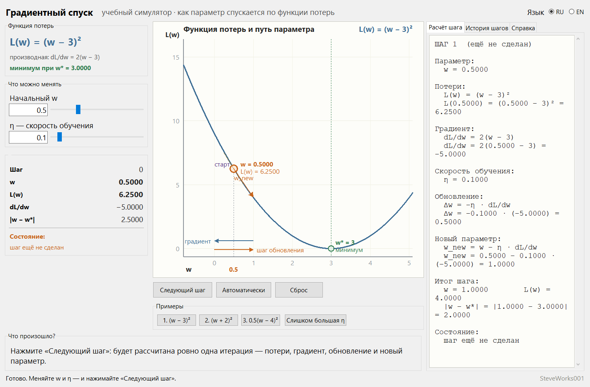
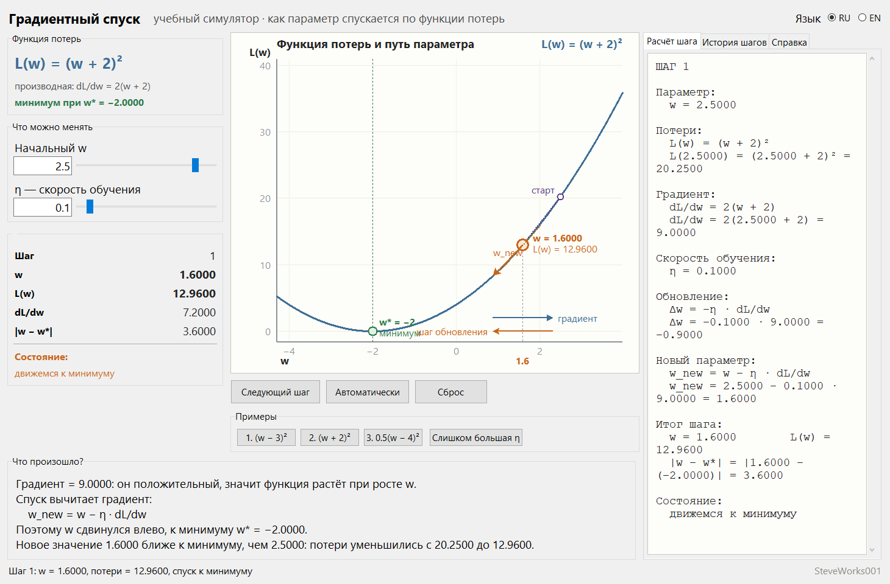
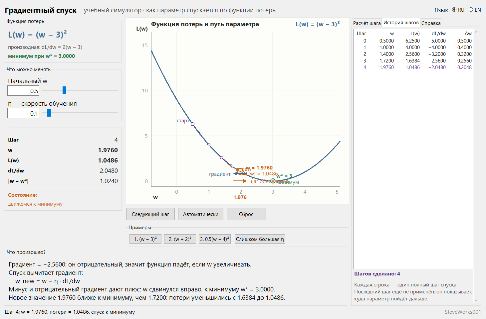
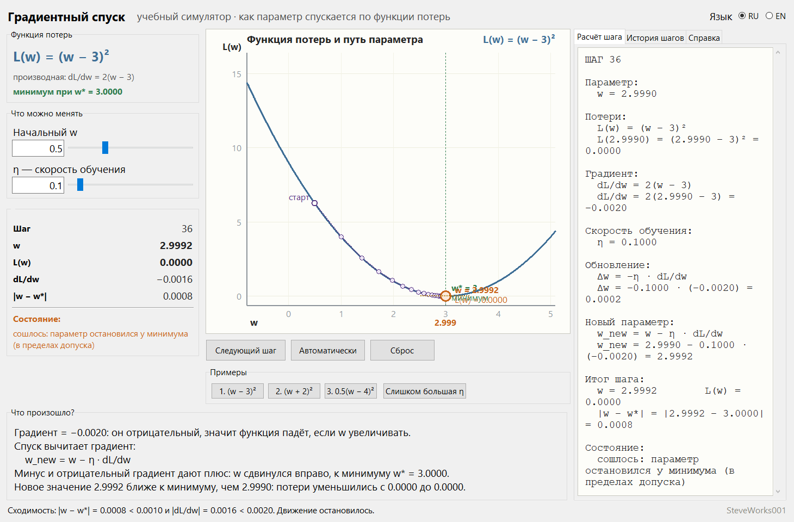

# Градиентный спуск — учебный симулятор

**[Русский](README_RU.md) | [English](README_EN.md)**

Проект 4 из 13 серии учебных симуляторов нейронных сетей.
Однофайловое приложение на Python и Tkinter: только стандартная библиотека,
без внешних пакетов, без сети и без установки зависимостей.
Показывает, как **один параметр спускается по функции потерь**: одно нажатие кнопки —
ровно одна итерация спуска, и вся арифметика этой итерации видна построчно.

---

## Назначение

Градиентный спуск не скрывает магии: на каждом шаге мы спрашиваем функцию потерь, куда ей
хуже, и делаем маленький шаг в обратную сторону. Один параметр, одна формула, одна кнопка
на итерацию — и через несколько нажатий видно, как число само находит минимум.

Здесь нет нейросетей, датасетов и библиотек машинного обучения. Вся математика умещается
на экран и читается строка за строкой:

```text
текущий параметр w
      ↓
потери L(w)
      ↓
градиент dL/dw
      ↓
обновление Δw = −η · dL/dw
      ↓
новый параметр w_new
      ↓
повторить
```

Меняете `w` или `η` — и можете вручную проверить каждое число до того, как оно применится.

### Чего в этом проекте нет

- нет обучения нейросетей, обратного распространения ошибки и спуска по датасету;
- нет стохастического градиентного спуска, Adam, RMSProp и momentum;
- нет многомерных, невыпуклых и шумных функций — параметр ровно один;
- нет датасетов, эпох, метрик качества и кривых обучения;
- нет NumPy, PyTorch, TensorFlow, сети, баз данных и API.

Одномерная гладкая функция, один параметр и точная производная — этого достаточно, чтобы
увидеть главный механизм. Всё остальное — отдельные проекты серии.

---

## Учебные цели

- Понять, что градиентный спуск — общий приём оптимизации, а не свойство одной параболы.
- Понять, почему градиент **вычитают**: он показывает направление роста потерь.
- Разобрать один шаг по частям: потери → градиент → обновление → новый параметр.
- Понять роль скорости обучения `η`: она превращает направление в конкретное число.
- Научиться читать знак градиента и предсказывать, куда сдвинется параметр.
- Увидеть численную сходимость: как `Δw` уменьшается от шага к шагу.
- Различать три режима поведения: монотонный спуск, перемахивание через минимум и
  расходимость.
- Понять, что минимум достигается «в пределах допуска», а не точно, и что этот допуск
  задан явно.

---

## Математика: один шаг спуска

**Оптимизация** — поиск таких значений параметров, при которых некоторая функция принимает
наименьшее возможное значение. Чтобы говорить «меньше», нужна функция, которая измеряет,
насколько плохо.

**Функция потерь** `L` и есть эта мера. В основном примере она зависит от одного-единственного
параметра `w`:

```text
L(w) = (w − 3)²          dL/dw = 2(w − 3)          минимум при w* = 3
```

При `w = 3` потери равны нулю; чем сильнее `w` отклонился от тройки, тем больше штраф. В
настоящем машинном обучении то же самое, только параметров миллионы, а не один.

**Производная** `dL/dw` отвечает на вопрос: «если увеличить `w` на самую малую величину,
насколько вырастут потери?» При `w = 0.5` она равна `−5`: потери уменьшаются, если `w`
увеличивать. Когда параметр один, производная и есть **градиент**; при многих параметрах
градиент собирает все частные производные в вектор и указывает направление наиболее быстрого
роста функции.

**Почему минус.** Градиент показывает, куда расти. Чтобы падать, надо идти против него:

```text
Δw = −η · dL/dw
w_new = w + Δw        то есть    w_new = w − η · dL/dw
```

Из-за этого минуса метод и называется **спуском**. Если бы градиент прибавляли, параметр
поднимался бы вверх по функции потерь.

**Скорость обучения** `η` превращает направление в конкретное число. Малая `η` — много
крохотных шагов; большая `η` — грубые прыжки через минимум. `η` подбирают не «магическим
числом», а по поведению спуска: для этого в программе есть ползунок и отдельная кнопка с
заведомо большим значением.

### Один шаг на числах по умолчанию

Стартовые значения: `w = 0.5000`, `η = 0.1000`. Первое нажатие «Следующий шаг» считает ровно
это — панель «Расчёт шага» после клика выглядит так, строка за строкой:

```text
ШАГ 1

Параметр:
  w = 0.5000

Потери:
  L(w) = (w − 3)²
  L(0.5000) = (0.5000 − 3)² = 6.2500

Градиент:
  dL/dw = 2(w − 3)
  dL/dw = 2(0.5000 − 3) = −5.0000

Скорость обучения:
  η = 0.1000

Обновление:
  Δw = −η · dL/dw
  Δw = −0.1000 · (−5.0000) = 0.5000

Новый параметр:
  w_new = w − η · dL/dw
  w_new = 0.5000 − 0.1000 · (−5.0000) = 1.0000

Итог шага:
  w = 1.0000        L(w) = 4.0000
  |w − w*| = |1.0000 − 3.0000| = 2.0000

Состояние:
  движемся к минимуму
```

Знак здесь и есть главное объяснение: градиент отрицательный, поэтому `Δw` положительный и
параметр сдвигается **вправо**, к минимуму.

Первые четыре шага:

| № шага | w до шага | L(w)   | dL/dw    | Δw     | w после шага |
|---|-------|----------|----------|--------|--------------|
| 0 | 0.5000 | 6.2500   | −5.0000  | 0.5000 | 1.0000       |
| 1 | 1.0000 | 4.0000   | −4.0000  | 0.4000 | 1.4000       |
| 2 | 1.4000 | 2.5600   | −3.2000  | 0.3200 | 1.7200       |
| 3 | 1.7200 | 1.6384   | −2.5600  | 0.2560 | 1.9760       |

Каждый следующий `Δw` получается из предыдущего умножением на `0.8`: чем ближе к минимуму,
тем меньше производная, тем осторожнее шаг. Тот же множитель `0.8 = 1 − 2η` появляется из
формулы устойчивости ниже.

### Сходимость

Минимум считается достигнутым по явному допуску, и оба условия должны выполняться
одновременно:

```text
|w − w*| < 0.001    и    |dL/dw| < 0.002
```

Приложение никогда не заявляет точную сходимость, когда значение лишь приблизительно
близко: в строке состояния печатаются фактические числа и сам допуск, например

```text
Сходимость: |w − w*| = 0.0008 < 0.0010 и |dL/dw| = 0.0016 < 0.0020.
```

Есть и пределы, за которые спуск не пускают: если `|w − w*|` превысит `60`, спуск
останавливается с пояснением, что он разсошёлся; если шагов накопится `100`, появляется
сообщение о том, что при такой `η` спуск идёт слишком медленно.

### Устойчивость: множитель (1 − 2η)

Для `L(w) = (w − 3)²` обновление можно переписать одной строкой:

```text
w_new − 3 = (1 − 2η)(w − 3)
```

Множитель `(1 − 2η)` решает всё: пока его модуль меньше `1`, каждый шаг ближе к минимуму,
чем предыдущий; при `|1 − 2η| > 1` (для этого примера — ровно при `η > 1`) прыжки растут и
спуск разваливается.

---

## Интерфейс и как пользоваться

Экран разделён на четыре зоны.

**Слева** — блок «Функция потерь» с формулой, производной и положением минимума; блок
«Что можно менять» с полями `Начальный w` и `η — скорость обучения` (у каждого поля своё
текстовое поле и ползунок); блок текущего состояния со значениями `Шаг`, `w`, `L(w)`,
`dL/dw`, `|w − w*|` и строкой состояния.

**В центре** — большой график, построенный из формулы, а не из картинки. Под ним кнопки
`Следующий шаг`, `Автоматически` / `Остановить`, `Сброс` и блок «Примеры».

**Справа** — три вкладки: «Расчёт шага» (полная арифметика текущего шага со всеми
подстановками), «История шагов» (таблица) и «Справка» — 10 разделов теории: что такое
оптимизация, функция потерь, параметр, производная, градиент, зачем нужен минус в формуле,
что такое скорость обучения, как устроен один шаг, что такое сходимость и что случается при
слишком большой `η`.

**Внизу** — панель «Что произошло?» с объяснением именно этого шага и строка состояния с
последним сообщением.

### Пошаговый режим

`Следующий шаг` — главный режим программы. Одно нажатие выполняет ровно одну итерацию:
точка подсвечивается, перемещается в новое положение, дорисовывается траектория,
пересобирается панель расчёта, добавляется строка в таблицу, увеличивается счётчик шага и
обновляются обе пояснительные панели. Подсветка короткая и не мешает читать числа.

До первого нажатия «Расчёт шага» показывает **предстоящий** шаг с пометкой
«ещё не сделан»: все числа уже на экране, и их можно проверить вручную до того, как они
будут применены.

### Автоматический режим

`Автоматически` повторяет тот же шаг каждые 700 мс. На время работы кнопка превращается в
`Остановить`, остановка возможна в любой момент. Режим прекращается сам, когда минимум
достигнут, когда кончился запас шагов или когда спуск разсошёлся. `Сброс` останавливает
автоматику гарантированно. Пошаговый режим остаётся основным: автоматика нужна только
чтобы одним взглядом увидеть весь путь.

### График

По горизонтали — параметр `w`, по вертикали — потери `L(w)`. На графике показаны: кривая
функции потерь, посчитанная из формулы; минимум `w*` — зелёная вертикальная линия, точка и
подпись; траектория спуска — фиолетовая пунктирная ломаная через все посещённые точки;
начальная точка — белый кружок с подписью «старт»; текущая точка — оранжевый круг с
подписями `w = ...` и `L(w) = ...`; отвес от неё к оси `w` с числовым значением под осью;
касательная в текущей точке — её наклон повторяет знак и величину `dL/dw` при текущем
масштабе осей; стрелка от текущей точки к следующей; и внизу поля графика две стрелки —
куда смотрит **градиент** и куда реально идёт **шаг обновления**.

Границы рисунка подстраиваются под траекторию: как только параметр уходит дальше, оси
пересчитываются, и путь остаётся целиком виден. Связь «число в панели ↔ точка на графике»
прямая: значение под осью `w` — то же `w`, что в панели состояния и в таблице истории.

### Поля `w` и `η`

Поле и ползунок связаны: печатайте число — ползунок поедет следом, двигайте ползунок —
число появится в поле. Допустимые пределы:

```text
η             от 0.005 до 1.20
Начальный w   от (w* − 6) до (w* + 6)
```

Допускается запятая как десятичный разделитель. Если ввести не число или выйти за предел,
приложение сообщит об этом в строке состояния и оставит последние правильные значения —
интерфейс не ломается. Любая правка `Начального w` или `η` обнуляет траекторию и начинает
спуск заново с новой точки, чтобы история всегда соответствовала текущим настройкам.

### Сброс

`Сброс` возвращает исходное состояние выбранного примера: начальное `w`, `η`, счётчик
шагов, траекторию, текущие потери и градиент, график и обе панели.

### Таблица истории

Вкладка «История шагов» — компактная таблица из пяти столбцов:

```text
Шаг | w       | L(w)     | dL/dw     | Δw
0   | 0.5000  | 6.2500   | −5.0000   | 0.5000
1   | 1.0000  | 4.0000   | −4.0000   | 0.4000
2   | 1.4000  | 2.5600   | −3.2000   | 0.3200
3   | 1.7200  | 1.6384   | −2.5600   | 0.2560
```

Строка описывает шаг целиком, поэтому `w` в ней — значение **до** шага, а результат шага
стоит в следующей строке (или в панели состояния, если следующих строк уже нет). В таблице
шаги нумеруются от нуля, а панель «Расчёт шага» пишет `ШАГ 1` для того же самого первого
шага: нумерация различается на единицу, это одна и та же итерация.

Последняя строка (выделенная цветом) — **предстоящий** шаг: тот же расчёт, который выполнит
следующее нажатие. Когда спуск закончен, такая строка не показывается.

Таблица даёт то, чего не даёт график: численную сходимость. Видно, что при `η = 0.1` `Δw` на
каждой следующей строке получается умножением предыдущего на `0.8`.

### Состояние спуска

Строка состояния бывает пяти видов: `шаг ещё не сделан`, `движемся к минимуму`,
`движемся от минимума — шаг слишком велик`, `сошлось: параметр остановился у минимума
(в пределах допуска)` и `спуск разсошёлся: каждый прыжок через минимум больше предыдущего`.
Панель «Что произошло?» описывает тот же шаг словами: каков знак градиента, куда из-за него
сдвинулся параметр и как изменились потери.

### Язык

Интерфейс полностью переводится на ходу, без перезапуска: кнопки, подписи, оси и легенда
графика, статусы, объяснения, справка, названия примеров, заголовки таблицы и сообщения об
ошибках. Математическая запись (`L(w) = (w − 3)²`, `dL/dw`, `η`, `Δw`, `w*`) одинакова на
обоих языках и не переводится.

---

## Скриншоты

Снимки сделаны из реально запущенного приложения (окно 1460 × 960 пикселей, русский
интерфейс).

**Главное окно** — основной пример `1. (w − 3)²` со значениями по умолчанию, шаг ещё не
сделан. На вкладке «Расчёт шага» видна вся арифметика предстоящего шага: `w = 0.5000`,
`dL/dw = −5.0000`, `Δw = 0.5000`, `w_new = 1.0000`:



**Один шаг на примере 2** — `L(w) = (w + 2)²`, старт `w = 2.5000`. Градиент положительный
(`+9.0000`), поэтому спуск вычитает его и параметр уходит влево к `w = 1.6000`; потери падают
с 20.2500 до 12.9600:



**История шагов** — тот же пример 1 после четырёх нажатий «Следующий шаг». Каждая строка —
один полный шаг, `Δw` в следующей строке получается из предыдущей умножением на `0.8`, а
последняя строка подсвечена: это ещё не применённый предстоящий шаг:



**Сходимость** — значения по умолчанию через 36 шагов: `w = 2.9992`, `|w − w*| = 0.0008`,
`|dL/dw| = 0.0016`. Справа — вкладка «Расчёт шага» с арифметикой 36-го шага и состоянием
«сошлось», внизу — строка состояния, где напечатаны сами числа и допуск:



---

## Примеры функций

Три готовые функции — чтобы было видно, что градиентный спуск общий для любых функций
потерь, а не свойство одной параболы.

| Кнопка | Функция | Производная | Минимум | Старт | η |
|---|---|---|---|---|---|
| `1. (w − 3)²` | `L(w) = (w − 3)²` | `dL/dw = 2(w − 3)` | `w = 3` | 0.5 | 0.10 |
| `2. (w + 2)²` | `L(w) = (w + 2)²` | `dL/dw = 2(w + 2)` | `w = −2` | 2.5 | 0.10 |
| `3. 0.5(w − 4)²` | `L(w) = 0.5(w − 4)²` | `dL/dw = (w − 4)` | `w = 4` | 0.5 | 0.40 |

Первый пример — основной, он загружается при запуске. Пример 2 показывает, что движение
может идти и влево. Пример 3 — более пологая парабола: производная там меньше, поэтому и
`η` по умолчанию больше, иначе спуск потребовал бы слишком много шагов.

Невыпуклых и многомерных функций здесь нет намеренно: сначала надо понять одномерный
случай.

---

## Эксперимент: как ведёт себя разная η

Кнопка `Слишком большая η` ставит `η = 1.05` на основном примере. Это не отдельный
алгоритм, а то же управление скоростью обучения, выведенное за пределы устойчивости:
множитель `1 − 2η = −1.1`, и каждый прыжок через минимум оказывается больше предыдущего.

Для основного примера, при старте из `w₀ = 0.5`, поведение спуска такое. Все строки
таблицы воспроизводимы: это тот же детерминированный расчёт с теми же
допусками (`|w − w*| < 0.001`, `|dL/dw| < 0.002`), лимитом 100 шагов и защитой при
`|w − w*| > 60`, которые стоят в приложении. При другом начальном `w` число шагов,
естественно, другое — таблица описывает именно этот старт:

| η | 1 − 2η | Как идёт спуск | Шаг | Результат |
|---|---|---|---|---|
| 0.02 | +0.96 | монотонно, очень медленно | 100 | не сошёлся, дошло до `w ≈ 2.958` |
| 0.10 | +0.80 | монотонно | 36 | сошлось |
| 0.30 | +0.40 | монотонно | 9 | сошлось |
| 0.35 | +0.30 | монотонно | 7 | сошлось |
| 0.50 | 0.00 | один шаг точно в минимум | 1 | `w = 3.0000` |
| 0.70 | −0.40 | прыжки через минимум, затухают | 9 | сошлось |
| 0.90 | −0.80 | долго затухающие прыжки | 36 | сошлось |
| 1.00 | −1.00 | вечный скачок между 0.5 и 5.5 | 100 | не сошёлся |
| 1.05 | −1.10 | прыжки растут, разнобой | 34 | остановлен защитой |
| 1.20 | −1.40 | быстрый разнобой | 10 | остановлен защитой |

Три вывода:

- **малая `η`** — надёжный, но вялый спуск;
- **умеренная `η`** — сходимость за несколько шагов;
- **большая `η`** — перемахивание через минимум, а при `η > 1` рост прыжков и полная
  потеря устойчивости.

Разница видна и на графике: в одном случае точки лепятся к минимуму, в другом траектория
расползается в стороны.

---

## Учебные опыты

Числа ниже — из того же детерминированного расчёта, который выполняет приложение при
значениях по умолчанию, так что они воспроизводимы: повторите опыт — получите ровно те же
строки. Считать самому полезнее, чем смотреть ответ, поэтому сначала бумага, потом кнопка.

**1. Предсказать предстоящий шаг.** Запустите программу и, ничего не нажимая, откройте
вкладку «Расчёт шага».
Наблюдайте: панель показывает ещё не сделанный шаг — `w = 0.5000`, `L(w) = 6.2500`,
`dL/dw = −5.0000`, `Δw = 0.5000`, `w_new = 1.0000`. Посчитайте эти пять чисел сами, затем
нажмите `Следующий шаг` и сверьте их с новой строкой таблицы истории.
О чём подумать: почему `Δw` положительный, если спуск идёт «вниз», и что именно показывает
знак производной в этой точке.

**2. Множитель 1 − 2η в таблице.** Сделайте четыре шага при `η = 0.10` и посмотрите на
столбец `Δw`: `0.5000, 0.4000, 0.3200, 0.2560`.
Наблюдайте: каждый следующий `Δw` получается из предыдущего умножением на `0.8`, то есть на
`1 − 2η`, и этот множитель не зависит от того, где вы сейчас находитесь. Нажмите `Сброс`,
поставьте `η = 0.30` и убедитесь, что множитель становится `0.40`, а спуск заканчивается за
9 шагов вместо 36.
О чём подумать: чему равен множитель при `η = 0.50` и почему в этом случае хватает одного
единственного шага.

**3. Знак градиента против направления шага.** Поставьте `Начальный w = 5.0` — правее
минимума `w* = 3`.
Наблюдайте: `dL/dw = +4.0000`, `Δw = −0.4000`, точка уходит влево, а две стрелки под
графиком — куда смотрит градиент и куда делается шаг — направлены в противоположные
стороны. Повторите при `Начальный w = 0.5` и убедитесь, что картина зеркальная.
О чём подумать: если направление полностью задаётся знаком, зачем спуску вообще величина
производной — и что изменится, если ту же производную домножить на другое `η`.

**4. Два разных «не получилось».** Нажмите `Слишком большая η` (это `η = 1.05`) и включите
`Автоматически`.
Наблюдайте: путь обрывается на 34-м шаге, а статус говорит про разнобой: `w` ушёл от
минимума `3.0000` дальше, чем на `60.0000`, — сработала защита по расстоянию. Теперь
`Сброс` и `η = 1.00`: множитель `−1.00`, прыжки не растут, точка вечно мечется между
`0.5000` и `5.5000`, и останавливает спуск уже лимит в 100 шагов — причём сообщение в этом
случае то же, что при очень малой `η`: программа жалуется на медленный спуск.
О чём подумать: почему одна и та же формулировка подходит и «вялому», и «периодическому»
случаю, и чем они принципиально различаются на графике.

---

## Установка и запуск

Приложение — один файл; сборки и установки зависимостей не требуется.

Windows:

```bash
python gradient_descent.py
```

macOS и Linux:

```bash
python3 gradient_descent.py
```

Окно открывается размером 1460 × 960 пикселей; если экран меньше, размер урезается под него,
но не ниже 1320 × 700. Быстрый старт: при запуске уже загружен основной пример `L(w) = (w − 3)²`, поэтому
достаточно несколько раз нажать `Следующий шаг`.

Переключатель языка — в шапке окна: **RU** / **EN**.

---

## Требования

- Python 3.8 или новее.
- Tkinter — входит в официальные сборки Python для Windows и macOS; в некоторых
  дистрибутивах Linux ставится отдельно как пакет `python3-tk`.
- Только стандартная библиотека: `math`, `tkinter`, `tkinter.ttk`, `tkinter.font`.
- Не используются: NumPy, pandas, SciPy, matplotlib, Pillow, TensorFlow, PyTorch, Keras,
  scikit-learn и любые пакеты из `pip`.
- Сетевое соединение для работы приложения не требуется.

Приложение рассчитано на типичный десктопный дисплей: график занимает центральную часть
окна. При размере по умолчанию правые панели — расчёта и истории — видны целиком: строки
блока расчёта переносятся по словам и нижняя не уходит под край, а пять столбцов истории
держатся даже в минимальном окне 1320 × 700. Если окно ниже по высоте, панель расчёта и
левая колонка прокручиваются.

---

## Ограничения

- Приложение **не обучает** нейросети: нет датасета, эпох, весов сети и обратного
  распространения ошибки.
- Параметр ровно **один**, функция — одномерная, гладкая и выпуклая; многомерных,
  невыпуклых и шумных функций здесь нет.
- Производная задаётся **аналитически** для каждого из трёх примеров: численного
  дифференцирования и автоматического взятия производной нет.
- Сходимость проверяется по фиксированному допуску (`|w − w*| < 0.001` и
  `|dL/dw| < 0.002`) — «точно в минимум» приложение не обещает.
- Пределы ввода заданы: `η` от 0.005 до 1.20, начальный `w` в пределах `w* ± 6`; числа вне
  диапазона не принимаются, а при любой правке траектория очищается.
- Числа считаются с обычной точностью `float`: при очень малой `η` спуск упирается в предел
  100 шагов, при большой — в защиту от разнобоя.
- Только графический интерфейс: нет консольного режима, API или пакетного запуска.
- Нет сохранения и загрузки: состояние не пишется в файлы, график не экспортируется.
- Два языка интерфейса: русский и английский.

---

## Учебная оговорка

Симулятор предназначен для понимания одного механизма — как шаг градиентного спуска
получается из потерь и производной. Отдельные соглашения выбраны ради наглядности: допуск
сходимости, предел в 100 шагов и защита при `|w − w*| > 60` решают, когда спуск считать
законченным, тогда как в настоящих системах это определяют другие критерии. Нумерация шагов
в таблице истории начинается с нуля, а панель расчёта нумерует тот же шаг с единицы.
Значения `η` по умолчанию подобраны под конкретные функции, а не взяты как «магическое
число» из практики обучения моделей.

---

## Что нужно знать заранее

**Строго необходимо:** Python 3 с Tkinter и запуск одного файла из командной строки.
Пакеты из `pip`, сеть и внешние файлы не нужны.

**Математика:** производная как наклон касательной — по существу она здесь и нужна. Но
дифференцировать самому не придётся: все три производные уже посчитаны и показаны на экране
вместе с формулой функции. Полезно умение работать со знаком числа и понимать, что значит
«мало»: весь критерий сходимости построен на двух неравенствах с допуском.

**Полезно, но не обязательно:** проекты 1 «Один искусственный нейрон» и 3 «Mini Neural
Network» — там по формуле считается одно число, а здесь появляется вопрос, как уменьшить
это число шаг за шагом.

**Про проект 2 «Перцептрон»:** там параметры меняются по правилу Розенблатта — по факту
ошибки, без производной. Сравнение двух правил и есть один из учебных смыслов этого
проекта, но знать перцептрон заранее не нужно.

**О версии Python:** раздел «Требования» называет Python 3.8 или новее. Само приложение
версию не проверяет, а запуск на других версиях не тестировался — это объявленная
совместимость, а не проверенная гарантия.

---

## Место в серии

Проект 4 из 13. Порядок не строгий: каждый проект запускается сам по себе и ничего не читает
из соседних. Ниже только те связи, которые есть по содержанию.

| Проект | Связь по содержанию |
|---|---|
| 1, 3 — Один искусственный нейрон, Mini Neural Network | там по формуле считается одно число; здесь появляется вопрос, как уменьшить это число шагом |
| 2 — Перцептрон | обучение без производной, по правилу Розенблатта: хороший контраст с тем, что делает этот проект |
| 5 — Backpropagation | там производная потерь по каждому весу появляется в многослойной сети; здесь она задана аналитически и видна целиком |
| 6 — Neural Network Training | тот же спуск, но по весам настоящей небольшой сети и по данным |
| 8 — Loss Functions | те самые функции потерь, производная по которым здесь и ведёт параметр |
| 11 — Optimizers | когда простого «минус градиент» не хватает: momentum, Adam и остальные |

---

## Разработчик

**Разработчик: SteveWorks001**

---

## Лицензия

Проект распространяется под лицензией [MIT License](LICENSE).
